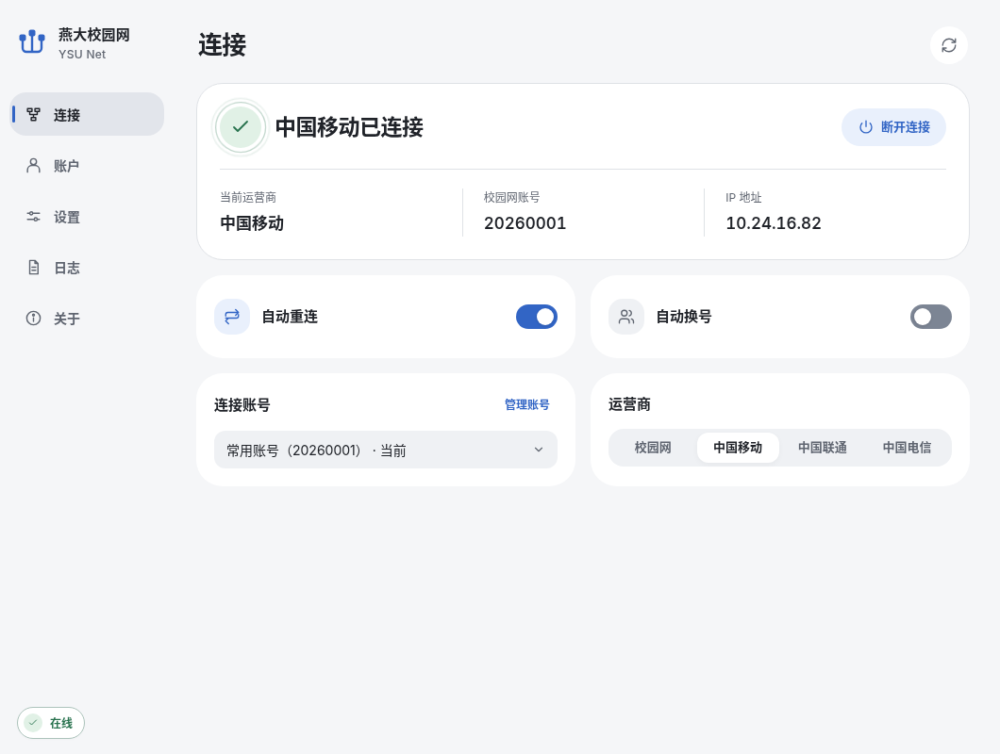
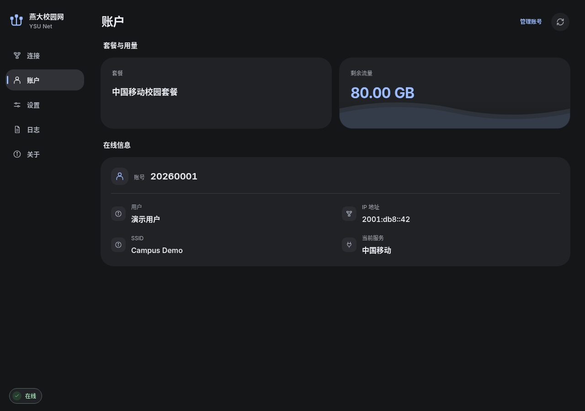
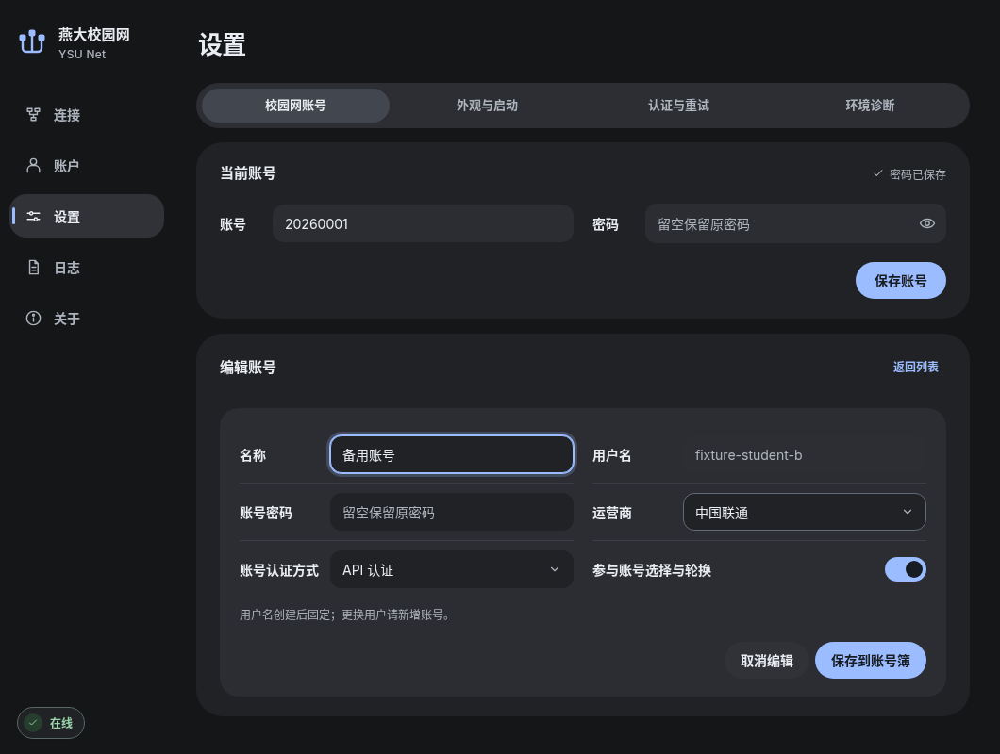

# ysu-net · 燕山大学校园网管理工具

校园网登录、运营商切换、账户查询与自动重连，提供跨平台桌面版和 Linux 命令行版。

[下载桌面版](https://github.com/wide-sky-with-me/ysu_net/releases/latest) · [命令行安装](#快速开始) · [使用说明](docs/usage.md) · [更新日志](packaging/release-notes.md)



截图来自 v0.2.3 云端界面演示，账号、地址与额度均为合成数据。[截图来源](docs/screenshots/README.md)

## 选择版本

| 版本 | 适用场景 | 运行方式 |
| --- | --- | --- |
| **桌面版** | Windows、Linux、macOS 日常使用 | Tauri + Svelte + Rust，支持托盘和用户登录自启，无需 Python / Node 认证运行时 |
| **命令行版** | Linux 服务器、终端与 systemd 后台 | Python 3.12，统一使用 `ysu`；无 systemd 时可前台守护 |

两端保持配置和认证语义兼容，各自运行认证逻辑；同一配置只运行一套自动重连。模块职责见[项目架构](docs/architecture.md)。

## 桌面版

### 发行与候选状态

**正式 v0.2.4 已发布并成为 Latest**。安装包来自 [GitHub Releases](https://github.com/wide-sky-with-me/ysu_net/releases/latest)，云端与真实环境验证范围见[发布记录](docs/desktop-release-0.2.4.md)。主分支源码、开发产物与正式安装包按各自提交区分。0.2.4 提供[可离线保留的链路调试记录](docs/debug-recording.md)，从“日志”页显式开启。

| 系统 | 安装包 |
| --- | --- |
| Windows 10 / 11 x64 | [下载 EXE](https://github.com/wide-sky-with-me/ysu_net/releases/download/v0.2.4/YSU-Net_0.2.4_windows-x64-setup.exe) |
| Ubuntu 22.04 及更新，x86_64 | [下载 DEB](https://github.com/wide-sky-with-me/ysu_net/releases/download/v0.2.4/YSU-Net_0.2.4_linux-x64.deb) |
| macOS 13.5+，Apple 芯片 | [下载 arm64 DMG](https://github.com/wide-sky-with-me/ysu_net/releases/download/v0.2.4/YSU-Net_0.2.4_macos-arm64.dmg) |
| macOS 13.5+，Intel | [下载 x64 DMG](https://github.com/wide-sky-with-me/ysu_net/releases/download/v0.2.4/YSU-Net_0.2.4_macos-x64.dmg) |

Windows / macOS 可主动检查更新；本次仅提供完整包，没有差分附件。Linux 通过系统包手动升级。旧 Qt / Inno 版和旧候选包先看[迁移说明](docs/migration.md#桌面-v024-升级)，更新与签名规则见[软件更新](docs/updates.md)。

### 主要功能

- **连接管理**：登录、下线、独立状态查询，支持校园网及中国移动 / 联通 / 电信服务。
- **账号池**：[多账号热切换与可选零流量自动换号](docs/accounts.md)，切换后核验实际账号与服务。
- **账户信息**：查看套餐、剩余流量与门户原始字段；缺失数据保持未知，不补造余额。
- **后台与外观**：托盘、用户登录自启、浅色 / 深色及多种主题色。
- **诊断与更新**：固定分类日志、本地环境诊断、随包更新日志与主动检查更新。

| 账户与剩余流量 | 账号管理 |
| --- | --- |
|  |  |

认证及状态语义见[Tauri 桌面说明](docs/tauri-desktop.md#运行语义)，完整界面规则见[设计说明](docs/rust-desktop-design.md)。

## 快速开始

以下为 **Linux 命令行版**。先准备 Git 和 [uv](https://docs.astral.sh/uv/getting-started/installation/)，再安装：

```bash
git clone https://github.com/wide-sky-with-me/ysu_net.git
cd ysu_net
bash install.sh
export PATH="$HOME/.local/bin:$PATH"
```

安装器创建 `.venv`、按锁文件安装依赖、注册用户级服务，并生成 `ysu`、`ysuon`、`ysuoff`；安装不会自动登录或启动重连。**请保留项目目录和 `.venv`**，命令及服务直接引用这里的运行环境。上面的 PATH 仅作用于当前终端，长期使用可加入 Shell 配置。

```bash
ysu config account    # 交互录入账号密码，密码不回显
ysu service           # 选择校园网 / 移动 / 联通 / 电信
ysu doctor            # 检查本地环境
ysu login             # 接入校园网后验证登录
ysu on                # 开启后台自动重连
ysu boot on           # 可选：启用用户服务自启
```

直接运行 `ysu` 打开菜单，非交互终端显示帮助。也可在项目内使用 `uv run python -m ysu_net`；安装后的包装命令可从任意目录运行。

| 常用命令 | 用途 |
| --- | --- |
| `ysu status` | 查询连接状态 |
| `ysu info` | 查看套餐与账户信息 |
| `ysu accounts` | 管理账号池与切换账号 |
| `ysu logout` | 退出当前校园网连接 |
| `ysu doctor --network` | 诊断网络与门户连接 |

登录和真实状态查询需要接入校园网；未接入时可先安装、配置和运行 `ysu doctor`。完整命令、配置位置及原始输出选项见[使用说明](docs/usage.md)。

<details>
<summary>可选安装方式与服务设置</summary>

```bash
bash install.sh --browser       # 额外安装浏览器认证运行时
bash install.sh --no-service    # 不注册服务
bash install.sh --offline       # 使用已有解释器、依赖和缓存
sudo env PATH="$PATH" bash install.sh --system  # 系统级安装
```

无 systemd 或用户总线时使用 `--no-service`，按[使用说明](docs/usage.md)运行前台守护。需要退出登录后继续运行的用户服务，可由管理员配置 `loginctl enable-linger`；安装器不自动启用。系统级安装、升级和卸载见[迁移指南](docs/migration.md)。

</details>

## 文档与交流

| 主题 | 文档 |
| --- | --- |
| 文档总览与入门 | [文档导航](docs/README.md) · [Wiki](docs/wiki/Home.md) · [GitHub Wiki](https://github.com/wide-sky-with-me/ysu_net/wiki) |
| 安装与日常使用 | [使用说明](docs/usage.md) · [多账号管理](docs/accounts.md) |
| 升级与版本验证 | [迁移指南](docs/migration.md) · [软件更新](docs/updates.md) · [验收记录](docs/desktop-acceptance.md) |
| 项目结构与开发 | [项目架构](docs/architecture.md) · [开发与验证](docs/development.md) |
| 参与项目 | [贡献指南](CONTRIBUTING.md) · [故障反馈](https://github.com/wide-sky-with-me/ysu_net/issues/new/choose) · [Discussions](https://github.com/wide-sky-with-me/ysu_net/discussions) |

分享日志或截图前移除真实账号、密码、会话及设备信息，参考[脱敏说明](docs/security.md#公开反馈的脱敏清单)。安全问题通过[私密报告入口](SECURITY.md)反馈。

终端交互参考 [clash-for-linux](https://github.com/wnlen/clash-for-linux)。

## 云端验证

编译、打包和产品测试仅在 GitHub Actions 执行。开发构建使用独立分支，不打正式标签或发布 Release；云端失败继续修复云端流程。本机只下载、校验产物并做安装与运行验收。

[原生桌面 CI](https://github.com/wide-sky-with-me/ysu_net/actions/workflows/tauri.yml) · [认证探针](docs/rust-auth-probe.md) · [构建前提](docs/tauri-desktop.md#构建前提) · [实际验证范围](docs/desktop-acceptance.md)
