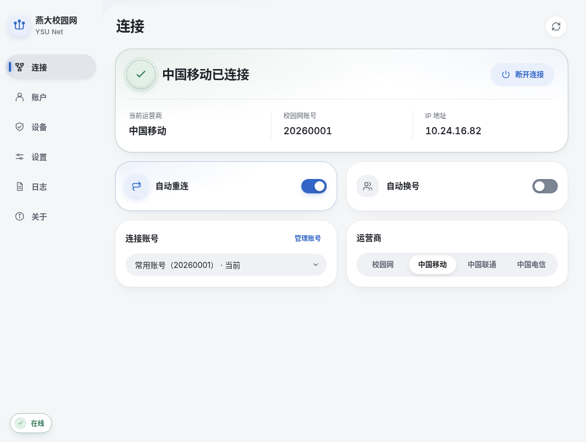
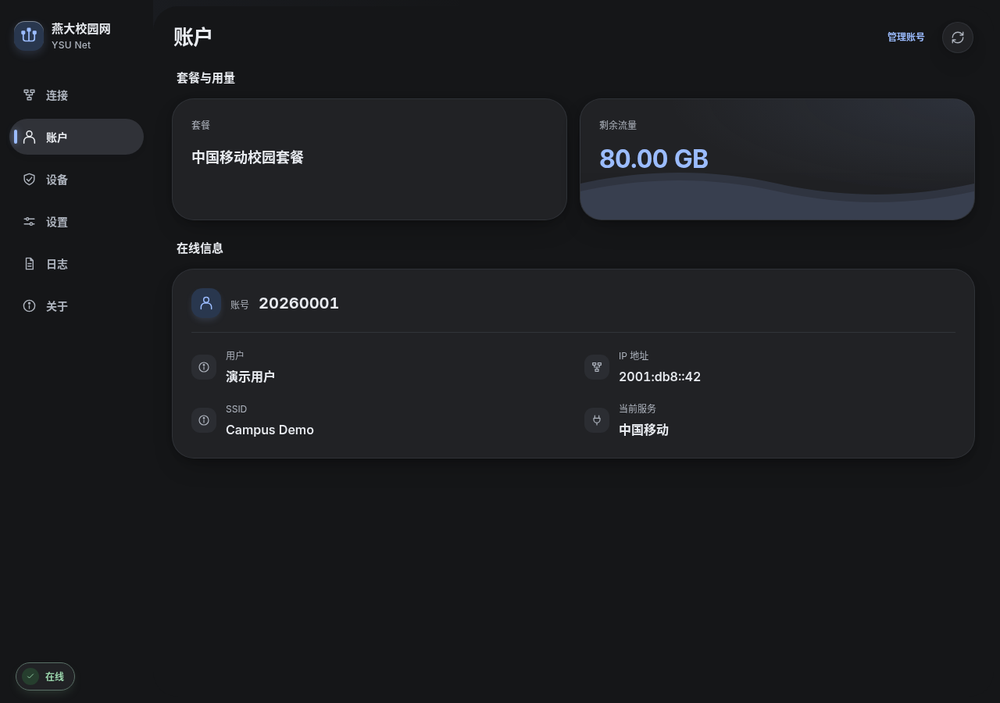
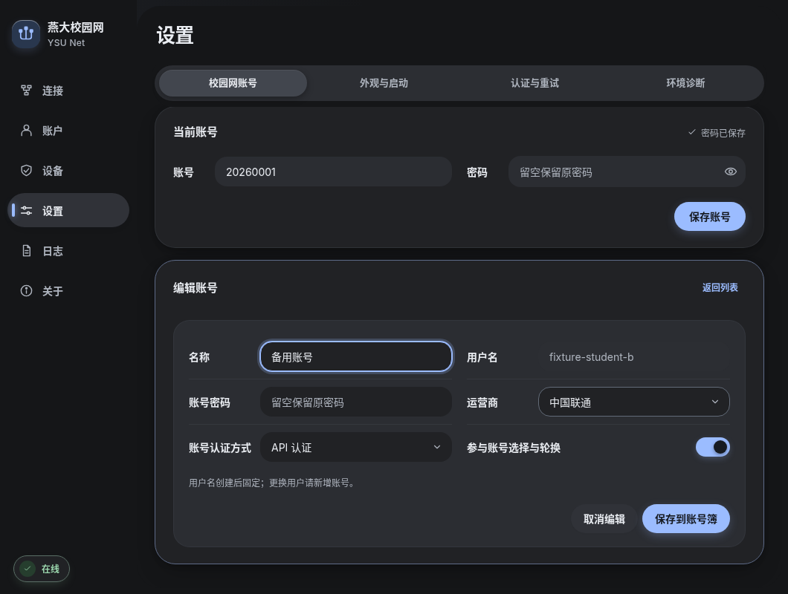

# YSU Net · 燕山大学校园网自动登录与管理客户端

[](https://github.com/wide-sky-with-me/ysu_net/actions/workflows/test.yml)
[](https://github.com/wide-sky-with-me/ysu_net/actions/workflows/tauri.yml)
[](https://github.com/wide-sky-with-me/ysu_net/actions/workflows/community.yml)
[](https://github.com/wide-sky-with-me/ysu_net/releases)
[](docs/tauri-desktop.md)
[](docs/tauri-desktop.md)
[](pyproject.toml)
[](LICENSE)

[快速开始](#快速开始) · [核心功能](#核心功能) · [桌面客户端](#桌面客户端) · [Linux 命令行](#linux-命令行) · [文档导航](docs/README.md) · [问题排障](docs/wiki/Troubleshooting.md)

**YSU Net** 是面向**燕山大学（燕大 / Yanshan University）**有线校园网与 **`iYanDa`** 无线校园网的跨平台自动认证与连接管理工具，完整对接学校锐捷 ePortal 认证门户（`auth1.ysu.edu.cn` / `auth.ysu.edu.cn`）、统一身份认证 CAS（`cer.ysu.edu.cn`）与校园网自助服务（`auth1.ysu.edu.cn/self`），同时提供 **桌面客户端（GUI）** 与 **Linux Shell 命令行（`ysu`）** 双版本：

- **桌面客户端（Windows 10/11 · Ubuntu/Debian Linux · macOS）**：Tauri + Rust 原生图形界面，内置系统托盘常驻、开机自启与软件内签名更新，无需安装 Python，适合宿舍个人电脑与笔记本开箱即用。
- **Shell 命令行版（`ysu`，Linux 服务器 / Ubuntu / Debian / WSL / SSH）**：纯终端交互菜单与无桌面脚本自动化，内置 `systemd` 后台常驻守护与极低内存占用，适合课题组服务器、工控机与远程主机无人值守联网。

双版本共用一致的配置与认证协议：支持一键登录与下线、四类宽带出口切换（**校园网 / 中国移动 / 中国联通 / 中国电信**）、断网自动重连、多账号池与零流量自动换号、在线设备查询与远程下线，以及 **7 天 MAC 无感认证与到期前后台自动续约**。

> [!IMPORTANT]
> **非官方开源声明**：本项目为社区维护的非官方工具，与燕山大学、锐捷网络及各宽带运营商（中国移动、中国联通、中国电信）无隶属、合作或官方授权关系。请仅用于本人合法持有或获明确授权的校园网账号与终端设备，遵守学校网络安全与统一身份认证管理规定，不得用于未授权访问或规避学校安全策略。账号密码仅保存在用户本机，不上传任何第三方服务器；若学校门户或认证策略升级，部分功能可能暂时失效，软件按 [MIT 许可证](LICENSE)「原样」提供。

| 连接页 · 浅色 | 账户页 · 深色 | 多账号池 · 深色 |
| --- | --- | --- |
|  |  |  |

---

## 核心功能

- **一键认证与断线重连**：默认采用轻量 HTTP API 完成 Portal + CAS 统一身份认证（自动绕过系统代理），支持校园网、中国移动、中国联通、中国电信四类出口切换，断网后按指数退避策略自动重连；内置跨重启持久化的失败熔断保护与可选**宿舍夜间停网保护**（周日–周四 `23:30–06:00` 静默暂停、晨间自动恢复）。
- **7 天无感认证与自动续约**：支持直接开启、关闭门户 7 天 MAC 无感认证并修改默认上网服务；开启「自动续约」后，后台会在 7 天有效期届满前 24 小时内自动解绑并重新绑定，彻底告别每周掉线重登。
- **多账号池与无缝换号**：支持保存多个校园网账号并配置启用状态与优先级，支持手动热切换，以及**剩余流量归零或认证设备数达上限时自动轮换**；切换账号时可自动解绑旧账号的本机无感认证并为新账号重新绑定。
- **在线设备与套餐管理**：直连校园网自助服务（`/self`），查看当前账号下的所有在线设备（名称、类型、MAC、IP、在线时长、接入方式）、计费套餐与剩余流量，支持远程下线单台或全部设备。
- **验证码自动识别与 DNS 容错**：内置可选离线验证码识别（`ddddocr` / ONNX）应对 CAS 验证码挑战；内置门户与认证域名备用 IP，在校园网 DNS 异常时自动回退连接并保持完整 HTTPS 证书校验。

---

## 快速开始

根据使用环境选择 **桌面版** 或 **Shell 命令行版**（同一台设备上请只开启其中一种后台自动管理）：

| 版本形态 | 适用系统 | 特点 | 获取与安装 |
| --- | --- | --- | --- |
| **桌面客户端** | Windows 10/11 x64<br>Ubuntu 22.04+ x64<br>macOS 13.5+ (Apple Silicon / Intel) | 圆润卡片图形界面、系统托盘驻留、开机自启、软件内检查更新（Windows / macOS），无需安装 Python | 前往 [GitHub Releases Latest](https://github.com/wide-sky-with-me/ysu_net/releases/latest) 下载最新安装包 |
| **Shell 命令行 (`ysu`)** | Linux 桌面、服务器、WSL、SSH 终端 | 极低资源占用、`systemd` 后台常驻守护、支持终端交互菜单与脚本自动化 | 克隆仓库后运行 `bash install.sh`（下方已附国内镜像一键命令） |

### 桌面版最新安装包（始终指向 `releases/latest`）

桌面安装包与更新清单由 GitHub Actions 在四平台构建并通过自检后发布至 **[GitHub Releases Latest](https://github.com/wide-sky-with-me/ysu_net/releases/latest)**：

| 平台 | Release 最新安装包 | 安装与升级方式 |
| --- | --- | --- |
| Windows 10 / 11 x64 | `YSU-Net_*_windows-x64-setup.exe` | 双击运行最新安装器（当前用户安装，免管理员权限）；后续可直接在「关于」页检查更新 |
| Ubuntu 22.04+ x64 | `YSU-Net_*_linux-x64.deb` | 下载最新 `.deb` 后执行 `sudo apt install ./YSU-Net_*_linux-x64.deb`（或直接运行下方一键命令） |
| macOS 13.5+ Apple 芯片 | `YSU-Net_*_macos-arm64.dmg` | 打开镜像并将 `YSU Net.app` 拖入「应用程序」；后续可在「关于」页检查更新 |
| macOS 13.5+ Intel | `YSU-Net_*_macos-x64.dmg` | 打开镜像并将 `YSU Net.app` 拖入「应用程序」；后续可在「关于」页检查更新 |

也可在终端直接拉取并运行每次 `latest` 发布的桌面安装包（已套好国内 GitHub 镜像 `ghfast.top`）：

- **Windows PowerShell 一键下载并启动最新安装器**：
  ```powershell
  $v = (Invoke-RestMethod "https://ghfast.top/https://github.com/wide-sky-with-me/ysu_net/releases/latest/download/latest.json").version
  Invoke-WebRequest "https://ghfast.top/https://github.com/wide-sky-with-me/ysu_net/releases/download/v$v/YSU-Net_${v}_windows-x64-setup.exe" -OutFile "$env:TEMP\ysu-net-setup.exe"
  Start-Process "$env:TEMP\ysu-net-setup.exe"
  ```
- **Ubuntu / Debian x64 一键下载并安装最新 `.deb`**：
  ```bash
  VER=$(curl -fsSL https://ghfast.top/https://github.com/wide-sky-with-me/ysu_net/releases/latest/download/latest.json | grep -o '"version": *"[^"]*"' | head -n1 | cut -d'"' -f4) && \
  curl -fL "https://ghfast.top/https://github.com/wide-sky-with-me/ysu_net/releases/download/v${VER}/YSU-Net_${VER}_linux-x64.deb" -o /tmp/ysu-net-latest.deb && \
  sudo apt install -y /tmp/ysu-net-latest.deb
  ```

> **macOS 首次打开提示**：由于安装包未使用付费 Apple Developer ID 公证，若首次启动提示“已损坏，无法打开”，请在终端执行：
> `sudo xattr -rd com.apple.quarantine "/Applications/YSU Net.app"`

---

## 桌面客户端

安装并打开 **YSU Net** 后，即可按侧栏分区完成全部操作：

1. **连接**：查看当前在线状态、运营商、学号与 IP；一键连接、断开、切换运营商，或开启「自动重连」与「零流量自动换号」。
2. **账户**：查看当前在线账号的套餐周期、剩余流量与门户连接详情。
3. **设备**：
   - 按账号池切换查看对应学号下的所有在线设备与本机物理网卡标识，支持远程下线单台设备或一键全部下线。
   - 在「无感认证（7天）」区域一键为本机或在线设备**开启 7 天无感认证**、**关闭无感**、**切换默认上网服务**，并开启**到期自动续约**。
4. **设置**：管理主账号与多账号池、切换浅色/深色主题与 6 种强调色（雾蓝、松石青、靛蓝、紫罗兰、玫红、琥珀黄）、配置开机自启、托盘驻留、自动更新策略与离线验证码识别模型。
5. **日志 / 关于**：查看运行日志、开启本地故障调试记录，或在「关于」页检查软件签名更新与查看版本记录。

详细说明请参阅 [桌面客户端指南](docs/wiki/Desktop-Client.md) 与 [Tauri 桌面版说明](docs/tauri-desktop.md)。

---

## Linux 命令行

### 1. 安装与初始化（已内置国内镜像源，复制粘贴即用）

```bash
# 1. 若尚未安装 uv，自动通过国内 GitHub 镜像拉取 latest 安装脚本完成安装
command -v uv >/dev/null 2>&1 || {
  curl -LsSf https://ghfast.top/https://github.com/astral-sh/uv/releases/latest/download/uv-installer.sh \
    | env UV_INSTALLER_GHE_BASE_URL="https://ghfast.top/https://github.com" sh
  export PATH="$HOME/.local/bin:$PATH"
}

# 2. 通过 GitHub 镜像克隆仓库，并使用清华 PyPI 源与 Python 镜像源安装 ysu 及后台服务
git clone https://ghfast.top/https://github.com/wide-sky-with-me/ysu_net.git
cd ysu_net
UV_INDEX_URL="https://pypi.tuna.tsinghua.edu.cn/simple" \
UV_PYTHON_INSTALL_MIRROR="https://ghfast.top/https://github.com/indygreg/python-build-standalone/releases/download" \
bash install.sh
export PATH="$HOME/.local/bin:$PATH"

# 3. 配置账号、选择运营商并立即上线
ysu config account               # 交互输入学号/工号与密码
ysu service                      # 选择运营商（校园网 / 中国移动 / 中国联通 / 中国电信）
ysu on                           # 立即登录并启动后台自动重连
```

可选安装参数（同样可附加在上述 `bash install.sh` 后）：
- `bash install.sh --captcha`：一并安装离线验证码识别依赖（`ddddocr`）。
- `bash install.sh --browser`：一并安装 Playwright 浏览器认证支持及 Chromium。
- `sudo env PATH="$PATH" UV_INDEX_URL="https://pypi.tuna.tsinghua.edu.cn/simple" UV_PYTHON_INSTALL_MIRROR="https://ghfast.top/https://github.com/indygreg/python-build-standalone/releases/download" bash install.sh --system`：安装为系统级服务（`/etc/ysu-net/config.json`，开机无需登录桌面即可联网）。

### 2. 常用命令速查

| 场景 | 命令 | 说明 |
| --- | --- | --- |
| **日常连接** | `ysu on` / `ysu off` | 启动后台自动重连 / 停止守护并下线 |
| | `ysu status` / `ysu info` | 查看连接状态 / 查看套餐与剩余流量 |
| | `ysu service 中国联通` / `ysu switch 中国联通` | 配置下次登录运营商 / 立即核验切换当前连接 |
| | `ysu night on` / `ysu night off` | 开启或关闭宿舍夜间停网静默保护（默认周日–周四 `23:30–06:00`） |
| | `ysu start` / `ysu stop` | 仅启动或停止后台自动重连（不下线当前连接） |
| **无感认证与续约** | `ysu self` | 查看在线设备、套餐流量、7 天无感认证与自动续约状态 |
| | `ysu self nosense current --service 中国联通` | 为本机开启 7 天无感认证并设置默认上网服务 |
| | `ysu self renew on` | 开启本机无感认证到期前 24 小时自动续约 |
| | `ysu self unbind current` | 取消本机（或指定序号/MAC、`all`）的无感认证 |
| | `ysu self kick 2 --yes` / `ysu self kick all --yes` | 下线指定设备或全部在线设备 |
| **多账号池** | `ysu accounts` / `ysu accounts list` | 打开多账号交互菜单 / 查看账号池状态 |
| | `ysu accounts save <学号> --service 中国联通` | 添加备用账号到账号池（交互隐藏输入密码） |
| | `ysu accounts switch <id>` | 热切换到指定账号（自动同步解绑/重绑本机无感认证） |
| | `ysu accounts rotation on` | 开启零流量或设备数达上限时自动切换到下一可用账号 |
| **排障与维护** | `ysu doctor` / `ysu logs -f` | 检查本地配置与运行环境 / 实时查看守护日志 |

完整参数、配置文件路径与高级用法请参阅 [命令与配置手册](docs/usage.md) 和 [多账号与无感联动说明](docs/accounts.md)。

---

## 文档导航

- **入门与使用**：[文档总览](docs/README.md) · [快速上手](docs/wiki/Quick-Start.md) · [桌面客户端指南](docs/wiki/Desktop-Client.md) · [命令行完整手册](docs/usage.md) · [多账号与自动换号](docs/accounts.md)
- **维护与排障**：[常见问题排障](docs/wiki/Troubleshooting.md) · [版本更新与卸载迁移](docs/migration.md) · [软件内签名更新](docs/updates.md) · [链路调试记录](docs/debug-recording.md)
- **架构与开发**：[产品与架构概览](docs/architecture.md) · [Tauri 桌面实现](docs/tauri-desktop.md) · [桌面界面设计](docs/rust-desktop-design.md) · [开发与测试指南](docs/development.md)
- **社区与安全**：[支持与反馈](SUPPORT.md) · [隐私与脱敏规则](docs/security.md) · [参与贡献](CONTRIBUTING.md) · [安全问题报告](SECURITY.md)

## 反馈与隐私

遇到问题请先查看 [常见问题排障](docs/wiki/Troubleshooting.md) 或运行 `ysu doctor`。公开提交 Issue 或 Discussion 前，请务必阅读 [公开反馈的脱敏清单](docs/security.md#公开反馈的脱敏清单)，切勿上传包含真实学号、密码、Cookie、会话票据、完整配置文件或未打码 IP/MAC 的内容。
