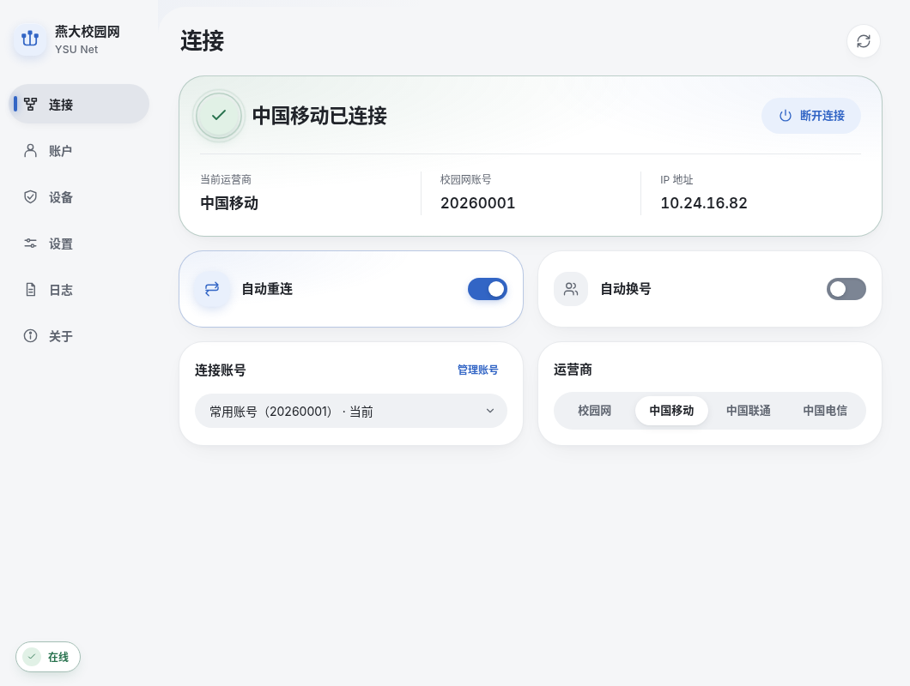
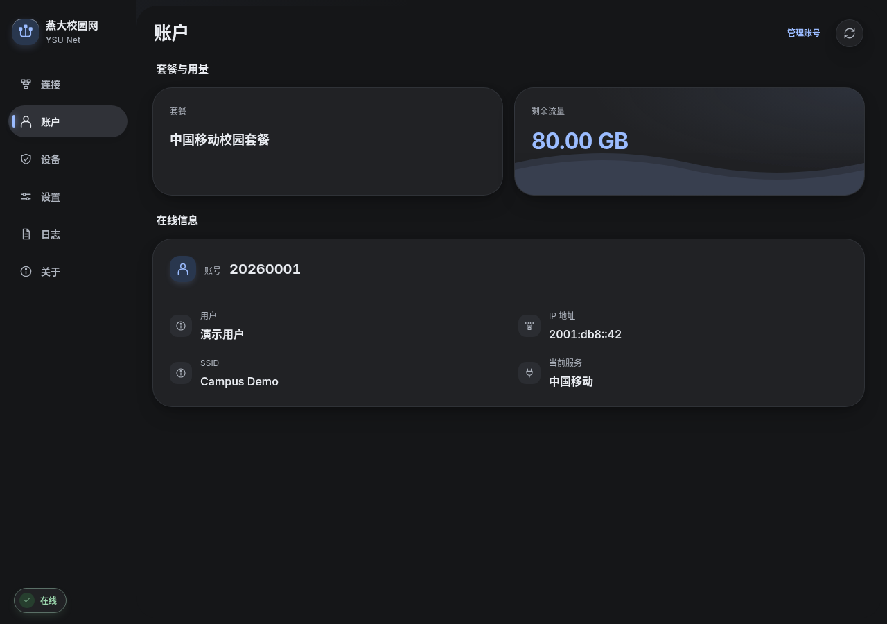
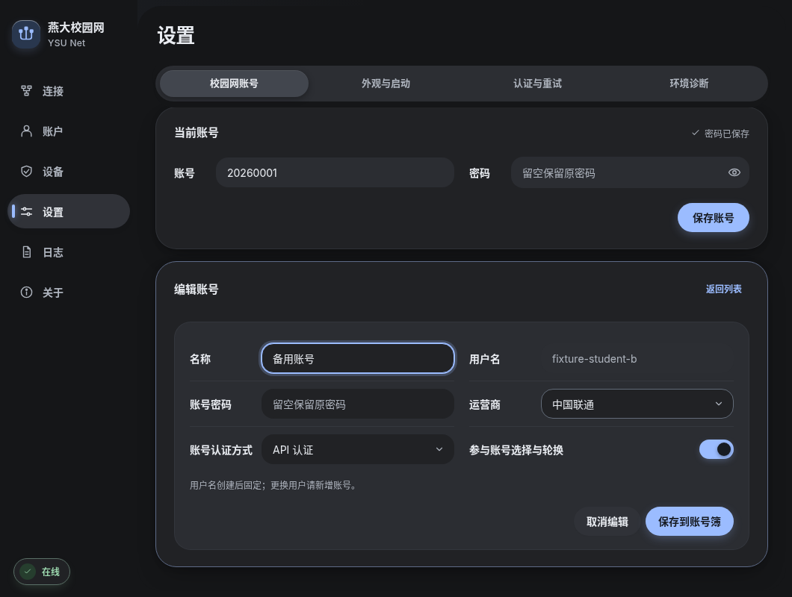

# ysu-net · 燕山大学校园网管理工具

校园网登录、运营商切换、账户查询、设备管理与自动重连，提供跨平台桌面版和 Linux 命令行版。

[下载桌面版](https://github.com/wide-sky-with-me/ysu_net/releases/latest) · [命令行安装](#命令行版) · [使用说明](docs/usage.md) · [更新日志](packaging/release-notes.md)



截图来自 v0.2.3 云端界面演示，账号、地址与额度均为合成数据。[截图来源](docs/screenshots/README.md)

## 选择版本

| 版本 | 适用场景 | 运行方式 |
| --- | --- | --- |
| **桌面版** | Windows、Linux、macOS 日常使用 | Tauri + Svelte + Rust，支持托盘和用户登录自启，无需 Python / Node 认证运行时 |
| **命令行版** | Linux 服务器、终端与 systemd 后台 | Python 3.12，统一使用 `ysu`；无 systemd 时可前台守护 |

两端保持配置和认证语义兼容，各自运行认证逻辑；同一配置只运行一套自动重连。模块职责见[项目架构](docs/architecture.md)。

## 桌面版

### 发行与候选状态

**正式 v0.2.8 已发布并成为 Latest**。安装包来自 [GitHub Releases](https://github.com/wide-sky-with-me/ysu_net/releases/latest)，云端与真实环境验证范围见[发布记录](docs/desktop-release-0.2.8.md)。主分支源码、开发产物与正式安装包按各自提交区分。

0.2.8 修复 0.2.7 桌面“设备”页快照解析遗漏与自助服务委托 CAS 跨站跳转问题，并优化桌面设备页与 `ysu self` 展示；设备自助服务（读取 `auth1.ysu.edu.cn/self` 在线设备、套餐与剩余流量及下线指定设备）与 0.2.6 引入的按需[验证码自动识别](docs/captcha-recognition-2026-11-07.md)（“设置 → 认证”，默认不启用）保持兼容。

| 系统 | 安装包（国内加速镜像 · GitHub 原链） |
| --- | --- |
| Windows 10 / 11 x64 | [国内镜像下载 EXE](https://gh-proxy.com/https://github.com/wide-sky-with-me/ysu_net/releases/download/v0.2.8/YSU-Net_0.2.8_windows-x64-setup.exe) · [GitHub](https://github.com/wide-sky-with-me/ysu_net/releases/download/v0.2.8/YSU-Net_0.2.8_windows-x64-setup.exe) |
| Ubuntu 22.04 及更新，x86_64 | [国内镜像下载 DEB](https://gh-proxy.com/https://github.com/wide-sky-with-me/ysu_net/releases/download/v0.2.8/YSU-Net_0.2.8_linux-x64.deb) · [GitHub](https://github.com/wide-sky-with-me/ysu_net/releases/download/v0.2.8/YSU-Net_0.2.8_linux-x64.deb) |
| macOS 13.5+，Apple 芯片 | [国内镜像下载 arm64 DMG](https://gh-proxy.com/https://github.com/wide-sky-with-me/ysu_net/releases/download/v0.2.8/YSU-Net_0.2.8_macos-arm64.dmg) · [GitHub](https://github.com/wide-sky-with-me/ysu_net/releases/download/v0.2.8/YSU-Net_0.2.8_macos-arm64.dmg) |
| macOS 13.5+，Intel | [国内镜像下载 x64 DMG](https://gh-proxy.com/https://github.com/wide-sky-with-me/ysu_net/releases/download/v0.2.8/YSU-Net_0.2.8_macos-x64.dmg) · [GitHub](https://github.com/wide-sky-with-me/ysu_net/releases/download/v0.2.8/YSU-Net_0.2.8_macos-x64.dmg) |

Windows / macOS 可主动检查更新；本次仅提供完整包，没有差分附件。Linux 通过系统包手动升级。macOS 安装包未经过 Apple 公证，Safari 等浏览器下载并拖入“应用程序”后若提示“已损坏，无法打开”，在终端执行 `sudo xattr -rd com.apple.quarantine "/Applications/YSU Net.app"` 后再打开。旧 Qt / Inno 版和旧候选包先看[迁移说明](docs/migration.md#桌面-v024-升级)，更新与签名规则见[软件更新](docs/updates.md)。

### 主要功能

- **连接管理**：登录、下线、独立状态查询，支持校园网及中国移动 / 联通 / 电信服务。
- **账号池**：[多账号热切换与可选零流量自动换号](docs/accounts.md)，切换后核验实际账号与服务。
- **账户信息**：查看套餐、剩余流量与门户原始字段；缺失数据保持未知，不补造余额。
- **设备自助服务**：读取门户自助服务的在线设备与套餐，核对后下线指定设备；下线前后各读一次列表，设备仍在在线就报失败。**只读查询会复用会话**，30 分钟内重复打开不会重新登录。
- **后台与外观**：托盘、用户登录自启、浅色 / 深色及多种主题色。
- **验证码识别**：桌面端在“设置 → 认证”按需下载约 52 MB 的识别模型，之后 CAS 验证码在本机识别；CLI 用可选依赖 `ddddocr`（`bash install.sh --captcha`）。模型不随安装包分发，未启用时仍按人工处理，见[验证码核验](docs/captcha-recognition-2026-11-07.md)。
- **诊断与更新**：固定分类日志、本地环境诊断、随包更新日志与主动检查更新。

| 账户与剩余流量 | 账号管理 |
| --- | --- |
|  |  |

认证及状态语义见[Tauri 桌面说明](docs/tauri-desktop.md#运行语义)，自助服务的设备页行为见[桌面使用指南](docs/wiki/Desktop-Client.md#设备自助服务)，完整界面规则见[设计说明](docs/rust-desktop-design.md)。

## 命令行版

提供交互式终端菜单（`ysu` / `ysu accounts`）、非交互子命令与 systemd 用户级 / 系统级后台重连，无 systemd 环境支持 `ysu daemon` 前台守护。

### 快速开始

在 **Linux 终端** 选择一个**持久目录**（普通用户如 `~/ysu_net`，系统级安装如 `/opt/ysu_net`；**切勿放在 `/tmp` 等临时目录**）克隆仓库。先准备 Git、Python 3.12+ 和 [uv](https://docs.astral.sh/uv/getting-started/installation/)，再执行安装：

```bash
git clone https://gh-proxy.com/https://github.com/wide-sky-with-me/ysu_net.git ~/ysu_net
cd ~/ysu_net
bash install.sh
export PATH="$HOME/.local/bin:$PATH"
```

生成的命令与 systemd 服务直接引用 `<项目目录>/.venv/bin/python`，安装后**不能删除或移动项目目录**（若移动目录，需在新位置重新执行 `bash install.sh`）；上面的 `PATH` 仅作用于当前终端，长期使用请写入 `~/.bashrc` 或 `~/.zshrc`。

| 安装范围 | 安装命令 | 命令入口 | 配置与账号簿 | systemd 单元 |
| --- | --- | --- | --- | --- |
| **当前用户（默认）** | `bash install.sh` | `~/.local/bin/{ysu,ysuon,ysuoff}` | `~/.config/ysu-net/config.json` | `~/.config/systemd/user/ysu-net.service` |
| **系统级（root）** | `sudo env PATH="$PATH" bash install.sh --system` | `/usr/local/bin/{ysu,ysuon,ysuoff}` | `/etc/ysu-net/config.json` | `/etc/systemd/system/ysu-net.service` |

安装不会自动登录或启动重连，按顺序完成首次配置与验证：

```bash
ysu config account    # 交互录入账号密码，密码不回显（系统级加 sudo）
ysu service           # 选择校园网 / 移动 / 联通 / 电信
ysu doctor            # 检查本地环境
ysu login             # 接入校园网后验证登录
ysu on                # 开启后台自动重连
ysu boot on           # 可选：启用服务自启
```

### 终端交互与常用命令

在交互终端直接运行 `ysu` 打开主菜单（输入 `15` / `h` / `?` 查看各项操作是否联网、是否中断当前连接），非交互终端显示帮助：

```text
YSU · 燕山大学校园网
────────────────────────────────────────────────────
  当前服务：中国移动 · API 认证
  账号：已配置
  管理范围：当前用户
  网络状态：按 1 查询
  → 首次使用或不确定操作影响？输入 15（或 h / ?）查看选项说明。

  连接管理
   1  查看状态                  2  登录一次
   3  开启自动重连              4  停止重连并下线
   9  仅停止重连               13  账户与剩余流量
  17  我的设备与自助服务

  配置与维护
   5  配置账号                  6  配置下次登录服务
   7  本地诊断 doctor          14  联网诊断 doctor
   8  查看日志                 12  查看配置
  10  开启自启                 11  关闭自启
  16  多账号与自动换号         15  选项说明（用途与影响）

   0  退出
```

| 常用命令 | 用途 |
| --- | --- |
| `ysu` / `ysu accounts` | 打开主交互菜单 / 多账号管理与热切换菜单 |
| `ysu status [--raw]` / `ysu info [--raw]` | 查询在线状态 / 查看套餐与剩余流量（支持 JSON） |
| `ysu self [--raw]` | 自助服务：在线设备、套餐、剩余流量与记住的上网选择 |
| `ysu self kick <编号\|all> [--yes]` | 下线指定设备（会中断该设备的连接，需确认） |
| `ysu switch <服务名>` | 立即切换运营商并独立核验，失败时尝试恢复原连接 |
| `ysu accounts switch <ID>` / `rotation on\|off` | 热切换已保存账号 / 开启或关闭零流量自动换号 |
| `ysu on`（`ysuon`） / `ysu stop` | 开启后台自动重连 / 仅停止重连并保留当前网络连接 |
| `ysu off`（`ysuoff` / `ysu logout`） | 停止自动重连并退出当前校园网连接 |
| `ysu logs -f` / `ysu doctor [--network]` | 持续跟随 systemd 日志 / 本地或联网诊断 |
| `ysu daemon` | 无 systemd 时的前台守护（Ctrl+C 停止） |

`ysu self` 登录自助服务读取只读数据，首次运行完整登录一次，之后 **30 分钟**内复用已保存的登录状态；`--fresh` 强制重新登录。频繁重试会触发统一认证的 IP 冻结，失败后不要循环重试。

登录和真实状态查询需要接入校园网；未接入时可先安装、配置和运行 `ysu doctor`。也可在项目目录内运行 `uv run python -m ysu_net`。完整子命令、配置项与退出码见[使用说明](docs/usage.md)。

<details>
<summary>可选安装方式与服务设置</summary>

```bash
bash install.sh --captcha       # 额外安装验证码自动识别依赖（ddddocr）
bash install.sh --browser       # 额外安装浏览器认证运行时
bash install.sh --no-service    # 不注册服务
bash install.sh --offline       # 使用已有解释器、依赖和缓存
sudo env PATH="$PATH" bash install.sh --system  # 系统级安装
```

无 systemd 或用户总线时使用 `--no-service`，按[使用说明](docs/usage.md)运行前台守护。需要退出登录后继续运行的用户服务，可由管理员配置 `loginctl enable-linger`；安装器不自动启用。系统级安装、升级和卸载见[迁移指南](docs/migration.md)。

</details>

## 文档与交流

| 主题 | 文档 |
| --- | --- |
| 文档总览与入门 | [文档导航](docs/README.md) · [Wiki](docs/wiki/Home.md) · [GitHub Wiki](https://github.com/wide-sky-with-me/ysu_net/wiki) |
| 安装与日常使用 | [使用说明](docs/usage.md) · [多账号管理](docs/accounts.md) · [设备自助服务](docs/wiki/Desktop-Client.md#设备自助服务) |
| 升级与版本验证 | [迁移指南](docs/migration.md) · [软件更新](docs/updates.md) · [验收记录](docs/desktop-acceptance.md) |
| 项目结构与开发 | [项目架构](docs/architecture.md) · [开发与验证](docs/development.md) |
| 参与项目 | [贡献指南](CONTRIBUTING.md) · [故障反馈](https://github.com/wide-sky-with-me/ysu_net/issues/new/choose) · [Discussions](https://github.com/wide-sky-with-me/ysu_net/discussions) |

分享日志或截图前移除真实账号、密码、会话及设备信息，参考[脱敏说明](docs/security.md#公开反馈的脱敏清单)。安全问题通过[私密报告入口](SECURITY.md)反馈。

终端交互参考 [clash-for-linux](https://github.com/wnlen/clash-for-linux)。

## 云端验证

编译、打包和产品测试仅在 GitHub Actions 执行。开发构建使用独立分支，不打正式标签或发布 Release；云端失败继续修复云端流程。本机只下载、校验产物并做安装与运行验收。

[原生桌面 CI](https://github.com/wide-sky-with-me/ysu_net/actions/workflows/tauri.yml) · [认证探针](docs/rust-auth-probe.md) · [构建前提](docs/tauri-desktop.md#构建前提) · [实际验证范围](docs/desktop-acceptance.md)
