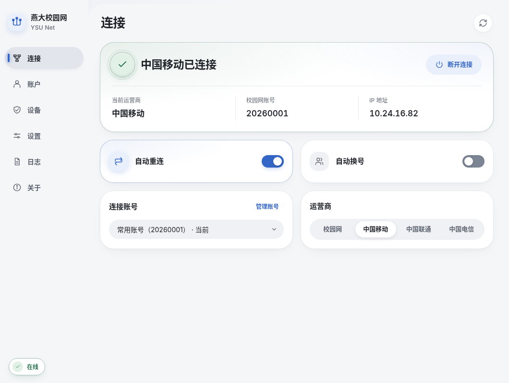
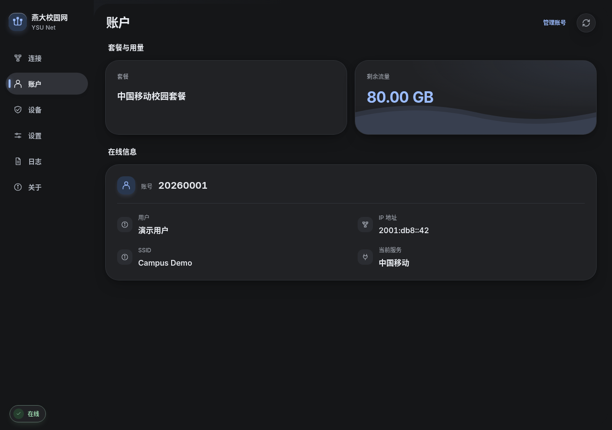

# 桌面界面设计规范

[返回首页](../README.md) · [文档导航](README.md) · [Tauri 桌面说明](tauri-desktop.md) · [产品与架构](architecture.md)

本页说明三平台共用 Svelte 5 桌面界面的布局结构、视觉层级、色彩主题与交互规范。样式与动效实现在 [`desktop/src/app.css`](../desktop/src/app.css)、[`desktop/src/accents.css`](../desktop/src/accents.css) 和 [`desktop/src/lib/motion.ts`](../desktop/src/lib/motion.ts)。

| 连接页 · 浅色 | 账户页 · 深色 |
| --- | --- |
|  |  |

---

## 布局与页面组织

- **自适应导航**：桌面宽屏采用左侧栏导航（`196px`），中等宽度自动收窄为图标侧栏（`80px`），窄屏（`520px` 及以下）切换为顶部导航栏。支持快捷键 `Ctrl+1` 至 `Ctrl+6` 直达连接、账户、设置、日志、关于和设备页。
- **连接页**：依次展示当前状态主卡（状态图标、在线运营商、学号、IP 与连接/断开按钮）、自动化开关（自动重连、零流量自动换号）、多账号快速切换与运营商切换。
- **账户页**：展示当前账号的套餐名称、计费周期与剩余流量（正数流量配轻量波纹装饰），下方以双列卡片展示门户在线详情字段。
- **设备页**：支持在顶部切换账号池中的查看账号；依次展示「套餐与自助设置摘要卡」、「在线设备列表」（支持单台下线与全部下线）以及「无感认证（7天）管理卡」（支持一键开启/关闭本机或设备无感认证、切换默认上网服务、开启到期前自动续约与立即续约）。
- **设置页**：按「账号」、「认证与重试」、「外观与启动」三个吸顶标签页分区组织。
- **全局反馈浮层**：操作加载与成功/错误结果统一显示在右上角（窄屏为底部）非阻断浮层中，不挤压正文布局。

---

## 色彩、字体与圆角

| 用途 | 浅色模式 | 深色模式 |
| --- | --- | --- |
| 页面底色 | `#f5f6f8` | `#151618` |
| 卡片表面 | `#ffffff` | `#212225` |
| 内部控件底色 | `#eff1f4` | `#2b2d32` |
| 主要正文 | `#202329` | `#e9ecf1` |
| 次级说明文字 | `#5f6570` | `#aeb4be` |
| 默认强调色（雾蓝） | `#3265c5` | `#9bbcff` |

- **表面层级**：通过底色明度区分页面背景、卡片与内嵌控件，不使用繁琐的外框描边或重阴影。
- **六种主题强调色**：内置雾蓝（`blue`，默认）、松石青（`teal`）、靛蓝（`indigo`）、紫罗兰（`violet`）、玫红（`rose`）与琥珀黄（`amber`），共享中性灰白/灰黑背景表面。
- **圆角与排版**：主卡片采用 `28px` 圆角，内部块 `18–20px`，输入框 `12px`，操作按钮采用胶囊造型；内置本地 `Inter Variable` 字体并搭配系统中文字体，数值统一启用等宽数字（`tabular-nums`）。

---

## 交互动效与无障碍

- **轻量过渡**：切页采用 `240ms` 淡入与轻上移；连接状态切换时播放一次 `450ms` 图标回弹，确认在线时主连接图标展示柔和双环扩散。
- **减少动效与离屏节能**：全面遵循系统 `prefers-reduced-motion: reduce` 偏好；当窗口最小化、隐藏或元素滚出视口时，自动暂停连接光环与流量波纹动画。
- **键盘与高对比度支持**：所有弹窗（`<dialog>`）、下拉框与标签页均保持完整的键盘焦点循环、`Esc` 关闭及 `forced-colors` 高对比度模式适配。
