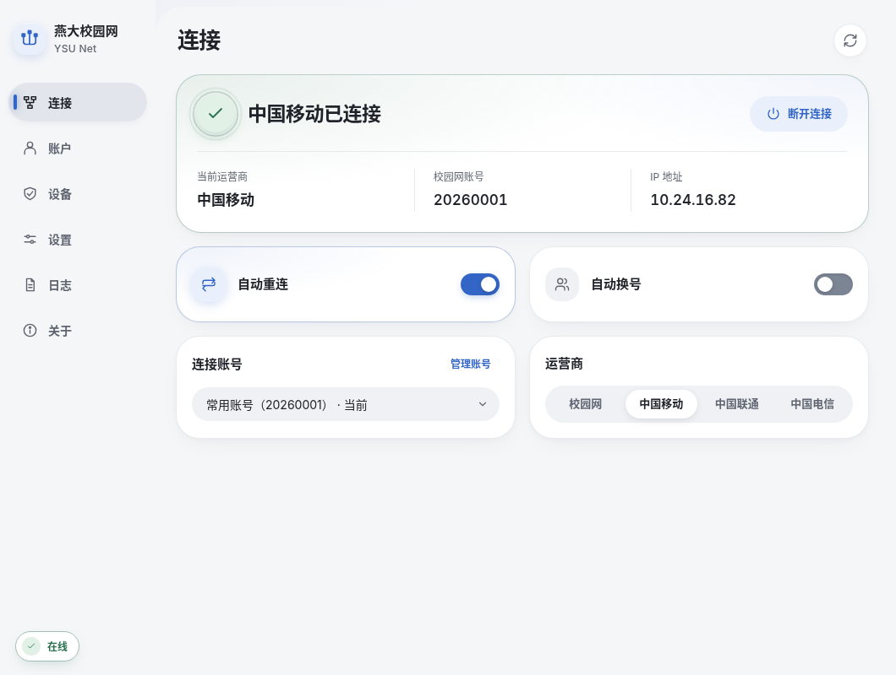

# 桌面客户端指南

[返回导航](Home.md) · [快速开始](Quick-Start.md) · [命令行速查](CLI-Reference.md) · [常见问题排障](Troubleshooting.md)

桌面客户端基于 Tauri 2 + Svelte 5 + Rust 原生构建，在 Windows、Linux 与 macOS 上提供统一的圆润卡片界面、状态感知柔光、弹性微交互动效与后台守护体验，支持快捷键 `Ctrl+1` 至 `Ctrl+6` 快速切换页面。

---

## 页面功能说明

### 1. 连接页（`Ctrl+1`）

- **状态与快捷控制**：展示当前在线状态、运营商、学号与本机校园网 IP；提供 **立即连接**、**断开连接**、**刷新状态** 与运营商一键切换。
- **自动化开关**：
  - **自动重连**：断网后按指数退避自动重连；即使关闭窗口隐藏到系统托盘，后台仍会持续守护。若连续登录失败达 3 次，或触发密码错误、风控拦截与无法识别的验证码，会自动暂停重连以避免触发 IP 冻结。
  - **零流量自动换号**：当检测到当前账号剩余流量归零时，自动按优先级切换到账号池中的下一个可用账号。
- **多账号快速切换**：存在多个已保存账号时，可直接从下拉列表选择目标账号并点击 **切换账号**。若旧账号为本机开启了 7 天无感认证，切换时会自动解绑旧账号并为新账号重新绑定。

### 2. 账户页（`Ctrl+2`）

- 展示当前在线账号的计费周期、套餐名称、剩余流量与门户在线详情。
- 点击右上角 **刷新账户** 可重新拉取最新套餐用量。

### 3. 设备页 · 在线设备与 7 天无感认证（`Ctrl+6`）

连接校园网自助服务（`/self`），集中管理设备与无感认证：

- **统一账号归属与切换**：页首固定展示当前「查询账号」，存在多账号池条目时可直接下拉切换，同步刷新设备列表与下方无感续约配置（即使该账号当前离线，也可直接读取并预绑无感认证）；若网关当前联网账号与所查账号不同，顶部会自动标出「当前联网 <学号>」提示。
- **在线设备识别与管理**：展示所选账号下的设备名称、类型（电脑/手机/其他）、MAC、IP、在线时长与接入方式，同时结合门户标记（`本机`）与本机物理网卡 MAC（`本机网卡`，自动忽略 VPN/TUN 虚拟网卡）辅助分辨当前电脑；无 MAC 信息的有线记录不显示无效的 **开启无感** 按钮，支持单台设备 **下线** 或多设备一键 **全部下线**。
- **无感认证（7天）与自动续约**：
  - **开启 / 关闭无感认证**：支持一键为本机或在线设备开启 7 天 MAC 无感认证（留空默认本机；若当前账号无在线设备会自动识别本机物理网卡 MAC），或随时取消单台/全部设备的无感绑定。
  - **默认上网服务**：直接修改无感认证放行时使用的运营商服务（校园网 / 中国移动 / 中国联通 / 中国电信）。
  - **到期前自动续约**：开启「自动续约」开关后，客户端后台会定期巡检开启续约的账号（常态每 6 小时检查一次，网络异常 30 分钟后重试，遇到需人工介入异常则自动暂停），在到期前 24 小时内（或已过期时）自动解绑并重新绑定 7 天；点击 **立即续约** 可手动立即刷新 7 天有效期。

### 4. 设置页（`Ctrl+3`）

- **账号**：设置主账号凭据，或新增、编辑、排序、启停和删除多账号池条目（详见 [多账号说明](https://github.com/wide-sky-with-me/ysu_net/blob/main/docs/accounts.md)）。
- **认证与重试**：调整状态检查间隔、重试间隔、操作超时、门户地址及认证方式（默认 `API`，可选本机 Edge/Chrome `浏览器` 模式），并可在「验证码识别」区域一键下载离线验证码模型。
- **外观与启动**：切换浅色/深色/跟随系统主题与 6 种强调色，配置 **开机自启**、**自启后进入托盘** 与 **关闭窗口最小化到托盘**。

### 5. 日志页（`Ctrl+4`）与关于页（`Ctrl+5`）

- **日志**：按级别筛选或搜索运行日志；遇到复杂网络故障时可开启 **开始调试记录**，将脱敏诊断信息写入本地目录以便排障（详见 [链路调试说明](https://github.com/wide-sky-with-me/ysu_net/blob/main/docs/debug-recording.md)）。
- **关于**：查看当前版本更新日志、项目仓库与贡献者名单；Windows 与 macOS 用户可在此点击 **检查更新**，验证签名后直接完成软件内升级（详见 [软件更新说明](https://github.com/wide-sky-with-me/ysu_net/blob/main/docs/updates.md)）。
